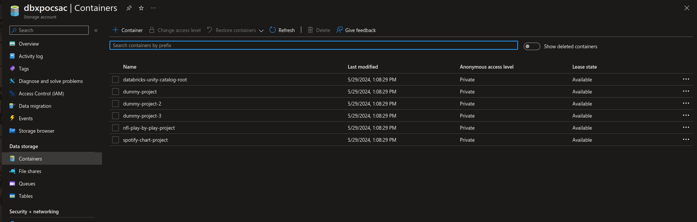
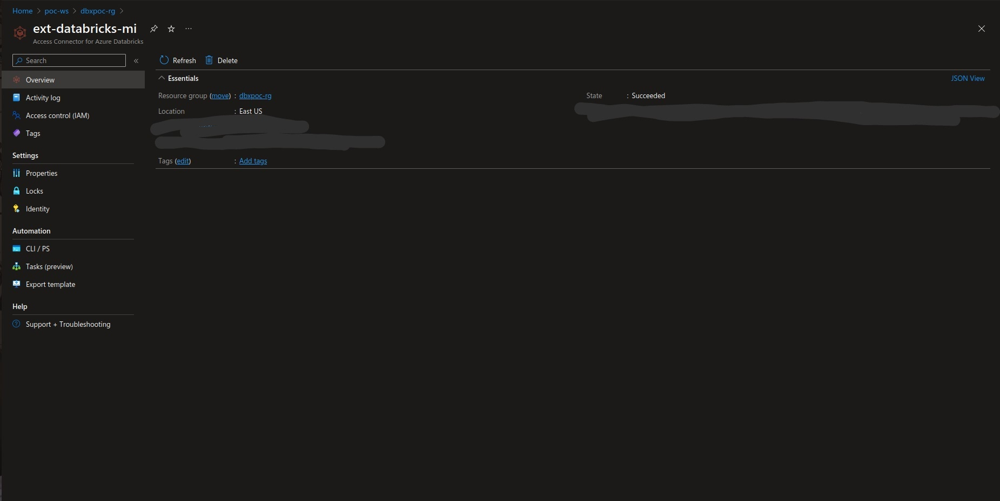
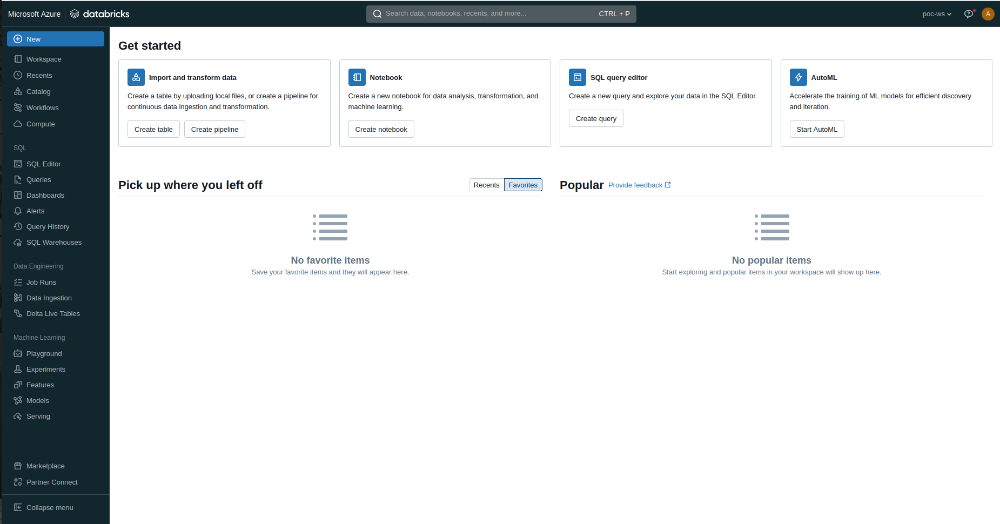
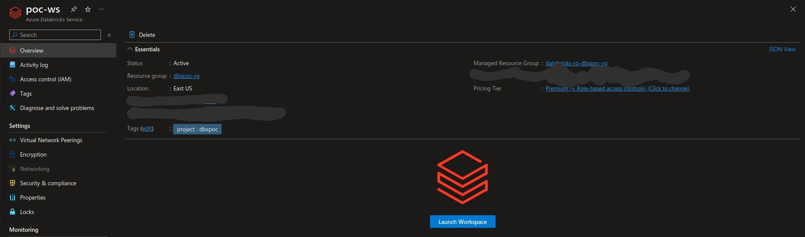
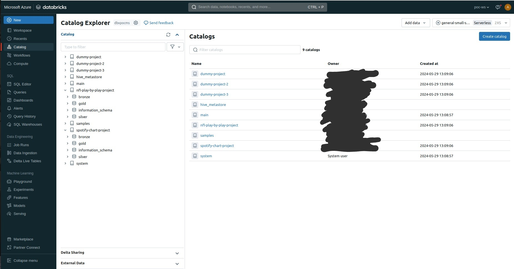

# databricks_poc
Terraform project for provisioning Azure + Databricks Lakehouse scaffolding.

This repository provisions:
- Azure Resource Group
- ADLS Gen2 Storage Account and project containers
- Azure Databricks Workspace
- Databricks Access Connector with RBAC on storage
- Unity Catalog storage credential, external locations, catalogs, and bronze/silver/gold schemas

Data product scaffolding is created from input variables and follows a [medallion data architecture](https://www.databricks.com/glossary/medallion-architecture).







## Prerequisites

- Azure CLI installed and authenticated (`az login`)
- Terraform installed
- Local `.env` values configured for your machine

## Canonical Workflow (Makefile)

Run from the `terraform/` directory.

```bash
cd terraform
make init
make validate
make plan ENVIRONMENT=poc ACTION=create
make apply ENVIRONMENT=poc ACTION=create
```

Destroy path:

```bash
cd terraform
make destroy ENVIRONMENT=poc
make apply ENVIRONMENT=poc ACTION=destroy
```

## Direct Terraform Commands (Alternative)

```bash
cd terraform
terraform init
terraform apply -auto-approve -var-file=environment/poc.tfvars
```

## Troubleshooting

- `make init` will use `terraform/local.azurerm.tfbackend` when present; otherwise it falls back to backend settings in `terraform/backend.tf`.
- If backend initialization fails, verify your backend values and Azure tenant/subscription context.
- If Databricks provider auth fails, refresh Azure CLI auth with `az login`.

## Out of Scope / Future Work

- Account-level Databricks automation (for example metastore lifecycle management) is not implemented in this repository today.

## Clean up Infrastructure

```bash
terraform destroy -auto-approve -var-file=environment/poc.tfvars
```

## Project Highlights

- Modular Terraform composition for Azure infrastructure and Databricks Unity Catalog scaffolding
- Parameterized multi-project container/catalog/schema provisioning
- Managed identity + RBAC access model for storage integration